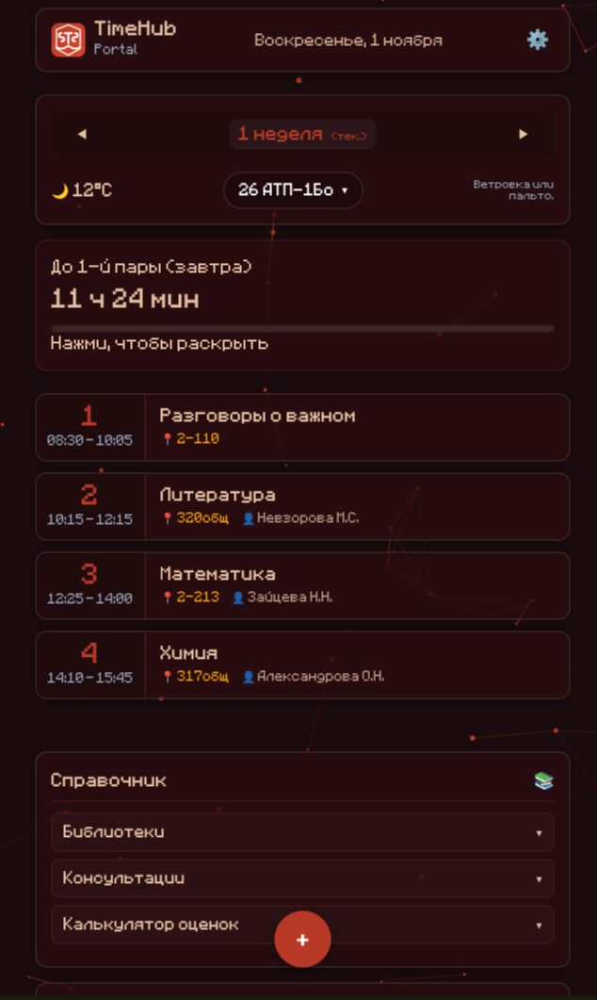
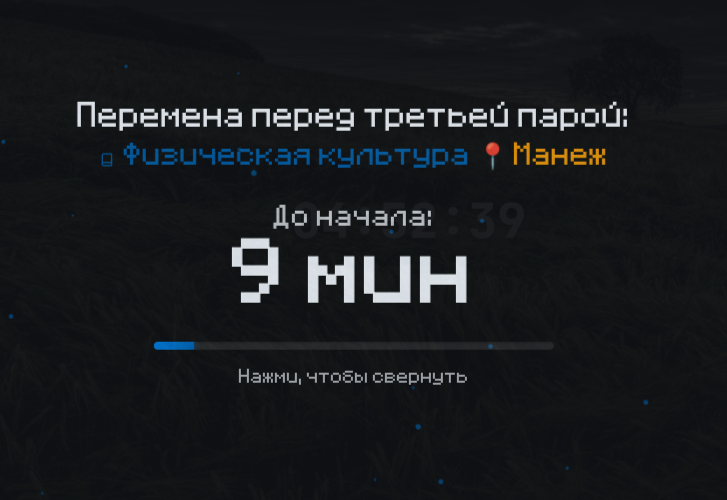
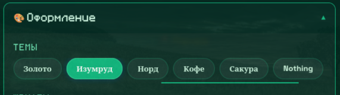
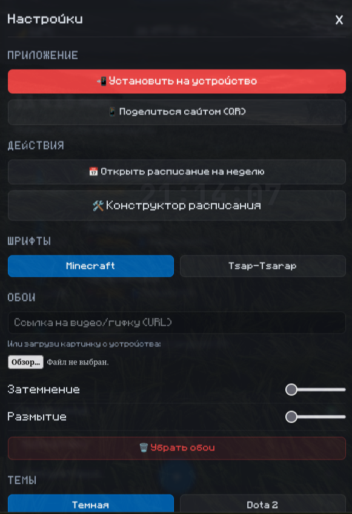
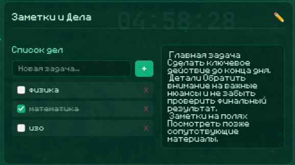
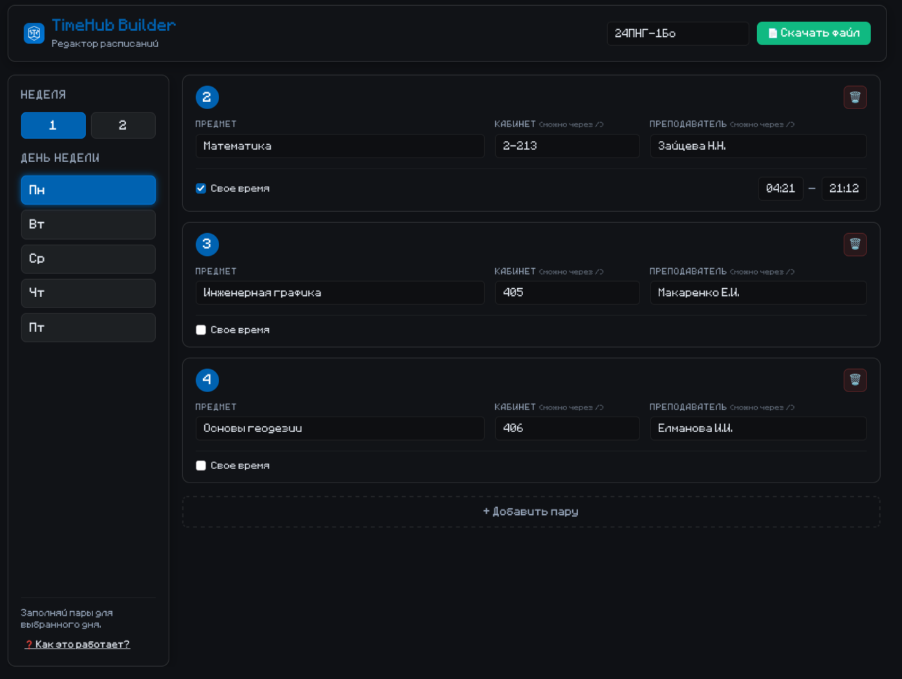

# TimeHub-Portal

Универсальный портал для студента: расписание пар, таймер до конца занятия, погода, заметки, чек-листы и система мотивации (стрик-огонек). Работает офлайн, устанавливается как PWA и интегрирован в Telegram.

Проект создан студентом Газпром колледжа Волгограда (группа 26 АТП-2Бо), но **открыт для любого учебного заведения**. Собери расписание своей группы в Конструкторе и добавь его на сайт!

[🌐 Открыть сайт](https://si2hay.github.io/TimeHub-Portal/) · [🛠️ Конструктор](https://si2hay.github.io/TimeHub-Portal/builder.html) · [✈️ Бот в Telegram](https://t.me/timehub_portal_bot/portal)

---

## 📸 Скриншоты

---

## ✨ Возможности

- **📅 Расписание:** Пары на день с учётом чётной/нечётной недели и замен.
- **🔥 Стрик:** Заходи каждый день, прокачивай огонек (меняет цвет до золотого).
- **☁️ Облако Telegram:** Заметки, чек-листы, стрик и настройки (тема, шрифт, URL-обои) синхронизируются между телефоном и ПК.
- **⏱️ Таймер:** Обратный отсчёт до конца пары или до следующей.
- **🌤️ Погода:** Сводка по Волгограду с советами по одежде. Можно выбрать API (Open-Meteo или wttr.in).
- **🎨 Кастомизация:** 12+ тем, 7 шрифтов, размер текста, свои обои (картинка/видео/URL).
- **📴 Офлайн-режим:** Открывается без интернета (Service Worker).
- **🛠️ Конструктор:** Сборка расписания для **любой** группы и генерация замен на конкретный день.

---

## 🚀 Как добавить расписание СВОЕЙ группы

Если твоей группы нет в списке:

1. Открой [Конструктор](https://si2hay.github.io/TimeHub-Portal/builder.html).
2. Введи название своей группы (например, `МГУ-1Б` или `26 АТП-4Бо`) и заполни пары.
3. Нажми **«Сгенерировать код»** и скачай файл `.js`.
4. Отправь этот файл в нашу [Telegram-группу](https://t.me/+sq9RDqa2I2A3M2Iy).
5. Мы добавим его на сайт, и твоя группа появится в общем списке!

---

## 💬 Связь и поддержка

- 💬 **Telegram-группа:** [https://t.me/+sq9RDqa2I2A3M2Iy](https://t.me/+sq9RDqa2I2A3M2Iy) (вопросы, предложения, добавление расписаний)
- 📧 **Почта:** gemg944@gmail.com

---

## 👤 Автор

Проект создан студентом **Газпром колледжа Волгограда** (группа 26 АТП-2Бо). 
Сайт является открытой платформой и не ограничивается одним учебным заведением.